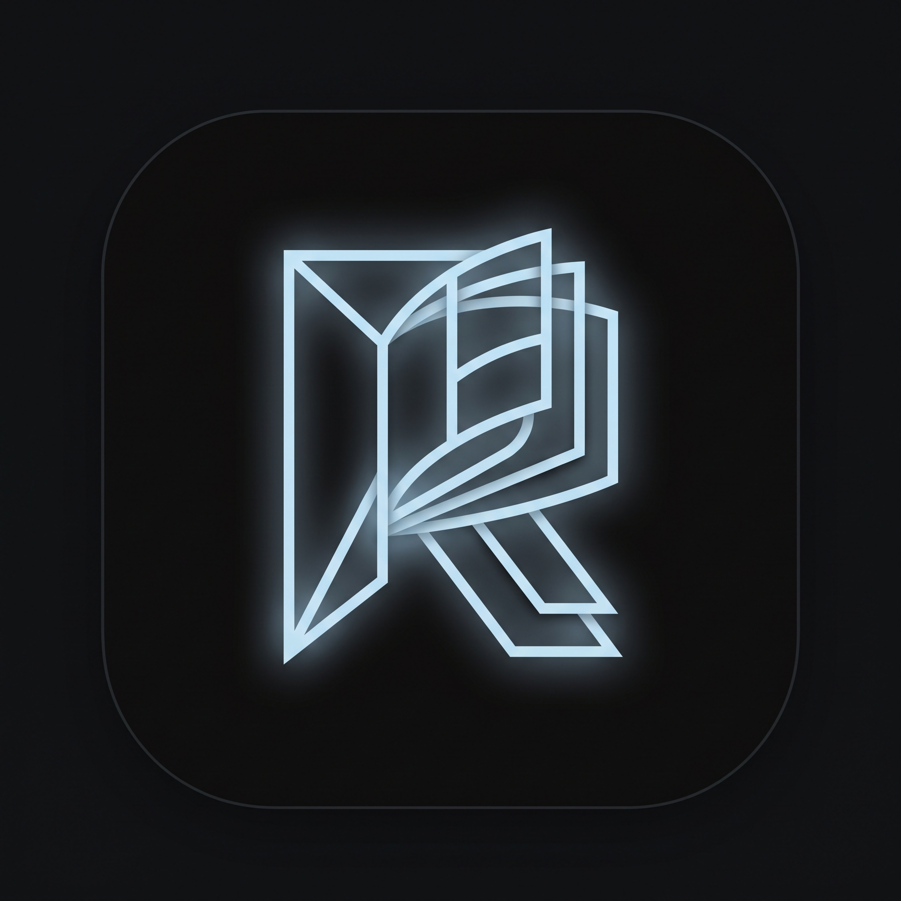

<div align="center">
  

  <h1>ReadToon</h1>

  <p><strong>Yerel arşivler için OLED Dark temalı, topluluk destekli yeni nesil manga ve manhwa okuyucusu.</strong></p>

  <p>
    <a href="https://flutter.dev"></a>
    
    <a href="https://riverpod.dev"></a>
    <a href="https://firebase.google.com"></a>
    <a href="#lisans"></a>
    
    <a href="https://github.com/efeyigitaltun/readtoon/releases"></a>
  </p>

  <p>
    <a href="https://github.com/efeyigitaltun/readtoon/releases">📥 GitHub Releases — APK indirme sayfası</a>
  </p>
</div>

ReadToon; manga, manhwa ve webtoon arşivlerini cihazından okumak, birden fazla
kaynak klasörünü yönetmek ve okuma ilerlemeni takip etmek için geliştirilen bir
Flutter uygulamasıdır. Yerel kütüphane ve okuyucu hesap gerektirmeden çalışır;
isteğe bağlı Firebase hesabı topluluk özelliklerini ve seçili kütüphane verilerini
cihazlar arasında eşitler.

> **Sürüm notu:** `pubspec.yaml` sürümü `1.0.0+1`. GitHub Releases sayfasını APK
> dağıtım yeri olarak kullan. Bu kaynak ağacında yayımlanmış `v1.0.0` APK'sı
> doğrulanmadığından indirme bağlantısı Releases sayfasına yönelir.

## Öne çıkan özellikler

### Isolate tabanlı okuyucu

- `.cbz` / `.zip` ve `.cbr` / `.rar` arşivlerini `compute` ile arka planda işler;
  büyük arşivlerin çözülmesi ana arayüz iş parçacığını mümkün olduğunca serbest
  bırakır.
- `.pdf` dosyaları `pdfx` ve Android'in yerel PDF renderer'ı üzerinden asenkron
  sayfa sayfa gösterilir. PDF çözümleme Dart Isolate özelliği olarak sunulmaz.
- Manga için sayfalı, webtoon için dikey kaydırmalı okuma deneyimi bulunur.
- Okuyucu motoru `IComicDecoder` arayüzü ve ZIP/CBZ, RAR/CBR ile PDF decoder'ları
  üzerinden ayrıştırılmıştır.

### Akıllı kütüphane ve klasör yönetimi

- Android Storage Access Framework (SAF) ile kullanıcının seçtiği yerel
  klasörlere erişim; birden fazla `Location` ekleme ve yönetme.
- Kütüphanedeki Locations paneli açılır-kapanır. Klasör kartları kitap sayısı,
  okunan/okunmayan durumu ve boyut gibi mikro istatistikleri gösterir.
- Okuma durumu ve seri/bölüm ilerlemesi kütüphane akışında takip edilir.

### OLED Dark tasarım

`#121212` arka plan, `#1A1A1A` kartlar, `#AEC6CF` pastel mavi vurgu ve `#E0E0E0`
metin renkleriyle düşük ışıkta rahat bir okuma arayüzü hedeflenir.

### AniList ve topluluk

- AniList GraphQL üzerinden manga, manhwa ve manhua keşfi; sorgularda
  `isAdult: false` filtresi kullanılır.
- Yerel bir arşiv AniList serisine kullanıcı tarafından bağlanabilir; eşleşme
  otomatik yapılmaz.
- Serilere puan verme, inceleme yazma ve topluluk incelemelerini canlı görme.
  Uygulama yorum bildirimi sunar; bu, uygulama içi bir moderasyon paneli olduğu
  anlamına gelmez.

### Konuk modu ve hesap senkronizasyonu

- Hesap açmadan yerel kütüphaneyi kullanma ve Keşfet'te gezinme.
- Google Sign-In veya e-posta/şifre ile giriş; kullanıcı profili, takip durumu,
  favoriler, puanlar, incelemeler ve seri/bölüm ilerlemesi Firestore ile eşitlenir.
- Hesap silme akışı kullanıcının bulut profilini ve ilişkili topluluk/kütüphane
  verilerini kaldırır. Yerel indirmeler cihazda kalır.
- Sayfa düzeyindeki yerel okuma geçmişi Hive'da tutulur; tüm bu geçmişin
  buluta eşitlendiği varsayılmamalıdır.

## Ekran görüntüleri

Aşağıdaki galeri, `docs/screenshots/` içine eklenecek görseller için yer tutucudur.

| Kütüphane | Okuyucu | Seri detayı | Profil |
|:---:|:---:|:---:|:---:|
|  |  |  |  |

> Görseller henüz depoda bulunmuyor. PNG ekran görüntülerini belirtilen dosya
> adlarıyla ekleyip bu tabloyu güncel tutun.

## Mimari ve teknoloji yığını

| Katman | Kullanım |
| --- | --- |
| Arayüz ve durum | Flutter widget'ları ve Riverpod provider'ları; ekranlar `presentation/` altında. |
| Yerel veri | Hive / Hive Flutter ile uygulama ayarları, kitaplık ve yerel okuma verileri. |
| Dosya erişimi | Android SAF, klasör tarama ve decoder'lara yönelik geçici yerel dosya köprüsü. |
| Okuyucu | `IComicDecoder` soyutlaması; ZIP/CBZ ve RAR/CBR işleri Dart Isolate üzerinde, PDF `pdfx` ile asenkron yerel render. |
| Bulut | Firebase Authentication ve Cloud Firestore; hesapla ilişkili kullanıcı verileri ve topluluk incelemeleri. |
| Harici katalog | AniList GraphQL API (`http` paketi), yetişkin içerik filtresiyle. |

### Önemli paket sürümleri

Sürümler `pubspec.yaml` içindeki mevcut kısıtları yansıtır; paket güncellemelerinde
`pubspec.yaml` ve `pubspec.lock` dosyalarını esas alın.

| Paket | Sürüm kısıtı | Rol |
| --- | --- | --- |
| Dart SDK | `^3.9.2` | Uygulama SDK aralığı |
| `flutter_riverpod` | `^2.6.1` | Durum yönetimi |
| `hive`, `hive_flutter` | `^2.2.3`, `^1.1.0` | Yerel veri ve önbellek |
| `firebase_core`, `firebase_auth`, `cloud_firestore` | `^5.1.0`, `^7.0.1`, `^7.1.0` | Firebase başlatma, kimlik doğrulama ve bulut veritabanı |
| `google_sign_in` | `^6.2.2` | Google ile giriş |
| `http` | `^1.6.0` | AniList GraphQL istekleri |
| `archive`, `koni_archive` | `^3.6.1`, `^0.9.0` | ZIP/CBZ ve RAR/CBR arşivleri |
| `pdfx` | `^2.11.0` | PDF sayfa render'ı |
| `saf`, `file_picker` | `^2.1.2`, `^8.1.7` | Yerel klasör/dosya seçimi |

### `lib/` proje ağacı

```text
lib/
├── app.dart
├── main.dart
├── firebase_options.example.dart
├── core/
│   ├── constants/
│   │   └── app_constants.dart
│   └── theme/
│       ├── app_colors.dart
│       └── app_theme.dart
├── data/
│   ├── decoders/
│   │   ├── comic_decoder_factory.dart
│   │   ├── i_comic_decoder.dart
│   │   ├── pdf_decoder.dart
│   │   ├── rar_cbr_decoder.dart
│   │   └── zip_cbz_decoder.dart
│   ├── models/
│   │   ├── anilist_media.dart
│   │   ├── app_settings.dart
│   │   ├── comic_book.dart
│   │   ├── community_review.dart
│   │   ├── folder_library_stats.dart
│   │   ├── read_history.dart
│   │   └── tracked_series.dart
│   └── services/
│       ├── anilist_service.dart
│       ├── archive_service.dart
│       ├── auth_service.dart
│       ├── file_picker_service.dart
│       ├── firestore_review_service.dart
│       ├── firestore_sync_service.dart
│       ├── library_scanner_service.dart
│       ├── permission_service.dart
│       └── saf_file_access_service.dart
└── presentation/
    ├── providers/
    │   ├── auth_provider.dart
    │   ├── discover_provider.dart
    │   ├── firestore_review_provider.dart
    │   ├── firestore_sync_provider.dart
    │   ├── firestore_sync_service_provider.dart
    │   ├── library_provider.dart
    │   ├── navigation_provider.dart
    │   ├── reader_provider.dart
    │   ├── settings_provider.dart
    │   └── tracked_series_provider.dart
    ├── screens/
    │   ├── auth_screen.dart
    │   ├── category_see_all_screen.dart
    │   ├── discover_screen.dart
    │   ├── library_screen.dart
    │   ├── profile_screen.dart
    │   ├── reader_screen.dart
    │   ├── series_detail_screen.dart
    │   ├── settings_screen.dart
    │   ├── setup_screen.dart
    │   └── tracking_list_screen.dart
    └── widgets/
        ├── comic_cover_card.dart
        ├── community_reviews_section.dart
        ├── link_comic_sheet.dart
        ├── locations_management_section.dart
        └── shimmer_loading.dart
```

Yerel dosyalar Hive ve SAF üzerinden cihazda kalır; kaynak manga arşivleri
Firebase'e yüklenmez. Oturum açılmışken hesapla ilişkili kütüphane ve topluluk
verileri Firestore servisleri üzerinden senkronize edilir.

## Kurulum ve geliştirme

### Gereksinimler

- Flutter SDK (Dart `^3.9.2` aralığıyla uyumlu)
- Android Studio / Android SDK ve Android cihaz veya emülatör
- Firebase projesi (Auth ve Firestore özellikleri kullanılacaksa)

### 1. Depoyu klonla

```bash
git clone https://github.com/efeyigitaltun/readtoon.git
cd readtoon
flutter pub get
```

### 2. Firebase'i yapılandır (isteğe bağlı bulut özellikleri)

1. Firebase Console'da `com.readtoon.readtoon` Android application ID'siyle bir
   uygulama kaydet ve **Authentication**'da E-posta/Şifre ile Google
   sağlayıcılarını etkinleştir. Google girişi için Android SHA-1 parmak izini
   Firebase Console'a ekle; sonra güncel `google-services.json` dosyasını indir.
2. `android/app/google-services.example.json` dosyasını yalnızca şablon olarak
   kullan. Kendi Firebase Console dosyanı `android/app/google-services.json`
   konumuna koy; şablonu gerçek proje kimlikleriyle doldurmak yerine kendi
   yapılandırmanı kullan.
3. FlutterFire CLI'ı kurup yapılandırmayı üret:

   ```bash
   dart pub global activate flutterfire_cli
   flutterfire configure
   ```

   Komutun oluşturduğu `lib/firebase_options.dart` yerel yapılandırmadır.
   `lib/firebase_options.example.dart` örnek dosyadır; gerçek proje değerleriyle
   üretilmiş dosyanın yerine geçmez.
4. Firestore veritabanı oluştur, `firestore.rules` kurallarını kendi projen için
   incele ve Firebase CLI ile yayınla:

   ```bash
   firebase deploy --only firestore:rules --project YOUR_FIREBASE_PROJECT_ID
   ```

Gerçek Firebase yapılandırma dosyaları Git tarafından takip edilmez; bunları
repoya ekleme. Firebase kurulumu olmadan yerel okuyucu ve Hive özellikleri
kullanılabilir, ancak Auth/Firestore özellikleri çalışmaz.

### 3. Çalıştırma ve Release APK

Debug sürümünü cihazda/emülatörde çalıştır:

```bash
flutter run
```

Release imzalama için `android/key.properties.example` dosyasını
`android/key.properties` olarak kopyala ve kendi keystore bilgilerinle düzenle.
Örnek Gradle yapılandırması `android/app/readtoon-release.jks` keystore yolunu
bekler; kişisel keystore'unu bu konumda oluştur veya properties içindeki yolu
uyarla. Örneğin:

```bash
keytool -genkeypair -v -keystore android/app/readtoon-release.jks -alias readtoon -keyalg RSA -keysize 2048 -validity 10000
flutter build apk --release
```

Windows PowerShell'de örnek yapılandırmayı kopyalamak için:

```powershell
Copy-Item android/key.properties.example android/key.properties
```

`android/key.properties`, keystore ve parolalar gizli tutulmalıdır; örnek dosya
haricindeki gerçek imzalama dosyalarını commit etme. APK çıktısı
`build/app/outputs/flutter-apk/app-release.apk` konumundadır. Release derlemesi
öncesinde gerçek Firebase ve imzalama yapılandırmalarının hazır olduğundan emin
ol.

## Yol haritası

### v1.0.0 temel kapsamı

- Yerel CBZ/CBR/ZIP/RAR ve PDF okuma; sayfalı ve dikey okuyucu modları.
- SAF tabanlı çoklu klasör kütüphanesi ve daraltılabilir Locations paneli.
- AniList keşfi, konuk modu ve isteğe bağlı Google/e-posta Firebase hesabı.
- Takip, favori, puan, inceleme ve seri/bölüm ilerlemesi için bulut eşitleme.
- Topluluk incelemesi bildirme ve hesap/bulut verisi silme akışları.

> Bu liste kaynak kodunda bulunan özellik kapsamını ifade eder; yayımlanmış bir
> APK veya mağaza sürümü bulunduğu iddiası değildir.

### Sonraki sürümler için fikirler

- Çevrimdışı önbellekleme ve senkronizasyon çatışması iyileştirmeleri.
- Okuma süresi, seri ve dönem bazlı istatistik grafikleri.
- Okuyucu kısayolları, erişilebilirlik ve tablet ekranı iyileştirmeleri.
- Google Play dağıtımına hazırlık ve mağaza materyalleri.

## Katkıda bulunma

Katkılar, hata bildirimleri ve öneriler memnuniyetle karşılanır:

1. Önce mevcut Issue'ları kontrol et veya kapsamı tartışmak için yeni bir Issue aç.
2. Değişikliğini küçük ve odaklı tut; arayüz değişikliklerine ekran görüntüsü ekle.
3. Kod biçimini ve statik kontrolleri doğrula: `dart format .`, `flutter analyze`
   ve ilgili `flutter test` testleri.
4. Pull request açıklamasında değişikliği, testleri ve gerekiyorsa Firebase/Android
   yapılandırma adımlarını belirt.

Kişisel Firebase yapılandırmalarını, `android/key.properties` dosyasını,
keystore'ları, kullanıcı verilerini veya telifli manga arşivlerini commit etme.

## Lisans

Depoda şu anda kök `LICENSE` dosyası bulunmuyor; bu nedenle proje henüz MIT
lisanslı olarak sunulmuyor ve MIT rozeti kullanılmıyor. Açık kaynak dağıtımından
önce hak sahibi tarafından seçilen lisansı `LICENSE` dosyası olarak ekleyin.
Lisans dosyası eklenene kadar yeniden kullanım ve dağıtım koşulları varsayılmamalıdır.
